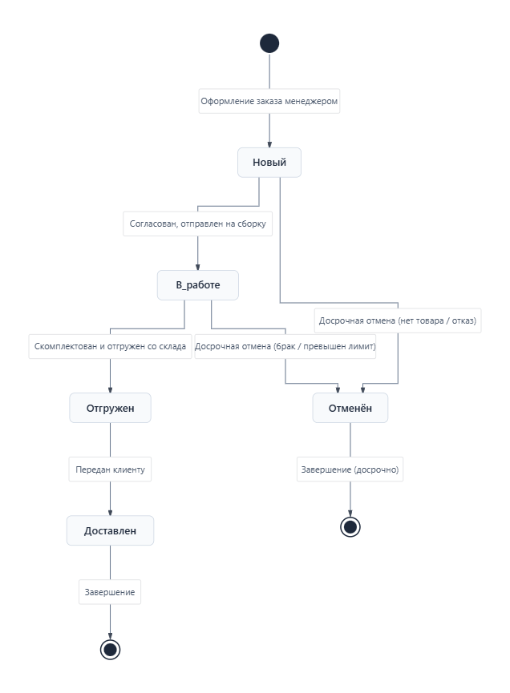
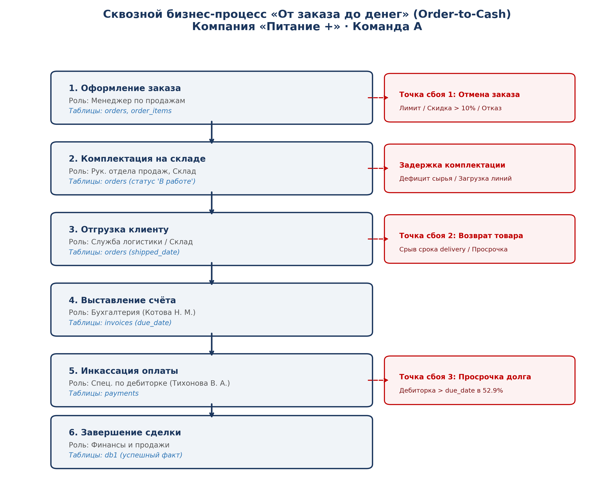
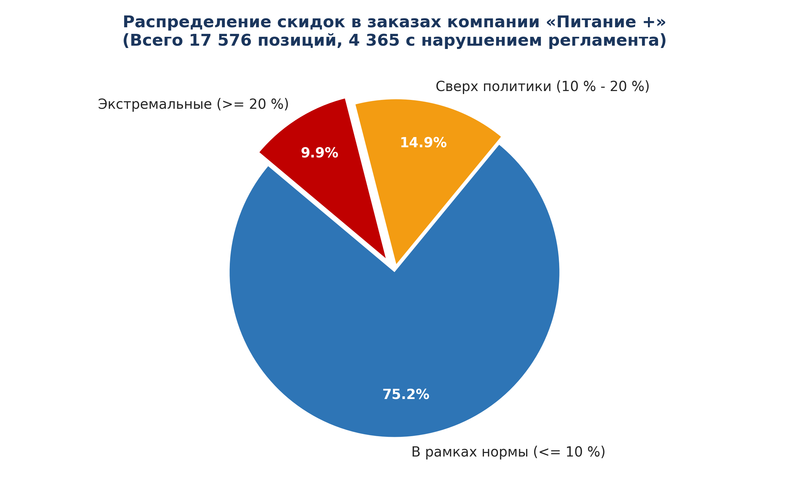
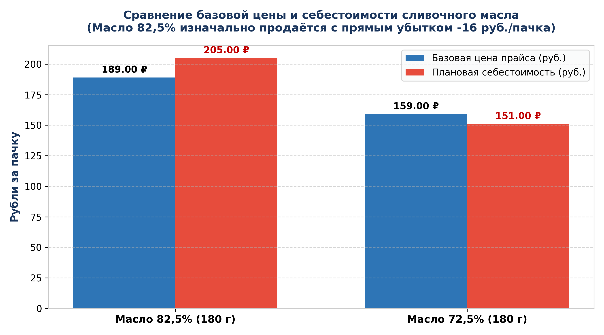
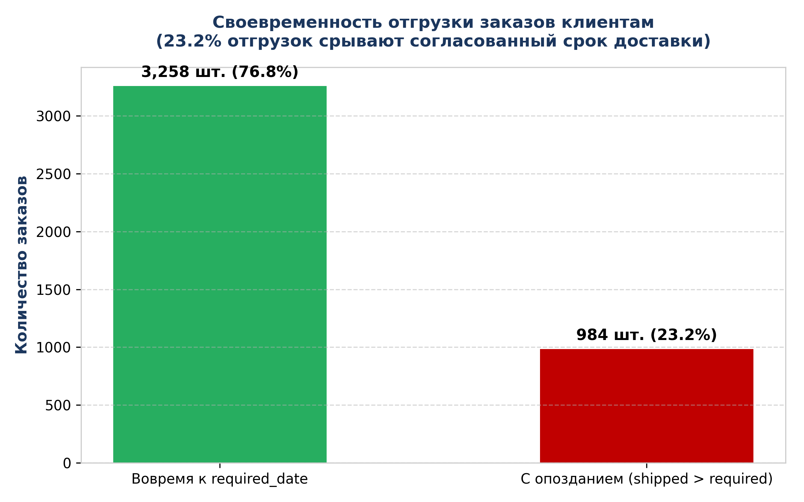

# AcademyIT_SQL

Репозиторий практических и лабораторных работ по курсу **«Углублённый SQL»** (Академия IT).  
Сквозной бизнес-кейс: производственно-торговая компания **«Питание +»**.  
СУБД: **PostgreSQL 16** (Yandex Managed Service for PostgreSQL).

---

## 👥 Команда А: «Финансы и продажи»
* **Исследуемый бизнес-процесс:** «От заказа до денег» (*Order-to-Cash*).
* **Схема базы данных:** `pitanie` (23 таблицы).
* **Цель аналитической группы:** выявление источников прямых и косвенных финансовых потерь, аудит соблюдения коммерческих регламентов, кредитной политики и ценообразования.

---

## 📁 Структура репозитория

```text
AcademyIT_SQL/
│
├── docs/                       # Аналитические отчеты в формате Word (.docx)
│   ├── Отчет_Модуль_0_Финансы_и_Продажи.docx   # Архитектура БД, классификация, Order-to-Cash
│   ├── Отчет_Модуль_1_Финансы_и_Продажи.docx   # Фильтрация, сортировка, первые улики
│   ├── Отчет_Модуль_2_Финансы_и_Продажи.docx   # Очистка данных, точные расчеты, убытки
│   └── Отчет_Модуль_3_Финансы_и_Продажи.docx   # Многотабличные JOIN, аудит долгов и логистики
│
├── sql/                        # SQL-скрипты с запросами и комментариями
│   ├── lab00_team_a.sql                        # Скрипт Модуля 0: связи, структура, аудит
│   ├── lab01_team_a.sql                        # Скрипт Модуля 1: фильтрация, улики, пагинация
│   ├── lab02_team_a.sql                        # Скрипт Модуля 2: функции, очистка, сроки, маржа
│   └── lab03_team_a.sql                        # Скрипт Модуля 3: JOIN, анти-джойны, проверки
│
├── images/                     # Ключевые схемы и диаграммы бизнес-процессов
│   ├── order_lifecycle_diagram.png             # Диаграмма переходов состояний заказа (Модуль 0)
│   ├── order_to_cash_process.png               # Сквозной маршрут Order-to-Cash и точки сбоя
│   │
│   └── charts/                 # Вторичные графики и визуализации аналитики
│       ├── 01_discounts_breakdown.png          # Распределение скидок по строкам заказов
│       ├── 02_butter_margin_analysis.png       # Сравнение базовой цены и себестоимости масла
│       ├── 03_shipment_punctuality.png         # Своевременность отгрузок заказов клиентам
│       ├── 04_payment_punctuality.png          # Платежная дисциплина (дебиторская задолженность)
│       └── 05_order_lifecycle.png              # Воронка статусов заказов в системе
│
├── .gitignore                  # Исключения кэша и служебных файлов
└── README.md                   # Документация проекта
```

---

## 🗺️ Маршрут процесса и жизненный цикл заказа (Модуль 0)

### 1. Диаграмма состояний заказа
В базе данных зафиксировано **4 458 заказов**. Жизненный цикл документа отслеживает его фазы от момента регистрации менеджером до передачи клиенту:
* `Новый` (22 шт.) ➔ `В работе` (17 шт.) ➔ `Отгружен` (30 шт.) ➔ `Доставлен` (4 212 шт.).
* На этапах «Новый» и «В работе» возможен досрочный срыв сделки ➔ переход в статус `Отменён` (177 шт.).

<p align="center">
  
</p>

---

### 2. Сквозной процесс «От заказа до денег» и критические точки сбоя
Каждый шаг процесса закреплен за соответствующей ролью и фиксируется в транзакционных таблицах БД:

<p align="center">
  
</p>

* **🔴 Точка сбоя 1 (Оформление):** Несанкционированные скидки менеджеров свыше 10% или превышение кредитного лимита ➔ отмена заказа.
* **🔴 Точка сбоя 2 (Отгрузка):** Срыв даты отгрузки (`shipped_date > required_date` в 23.2% случаев) ➔ порча скоропортящейся продукции (кефир со сроком 10 дней) и возврат товара клиентом.
* **🔴 Точка сбоя 3 (Оплата):** Просрочка платежей (`payment_date > due_date` в 52.9% случаев) ➔ заморозка оборотного капитала и кассовые разрывы.

---

## 🔍 Ключевые аналитические находки (Модуль 1)

<details>
<summary><b>📊 Нажмите, чтобы развернуть подробные результаты аудита и графики</b></summary>

### 1. Несанкционированные скидки сверх регламента 10 %
Политикой компании запрещены скидки более 10 %. Однако в данных **4 365 позиций (24.8 % всех продаж)** отгружены со скидками до 25 %.  
* **Суммарный перерасход сверх норматива:** **17 979 376,44 ₽**!
* **Персональная улика:** Все 10 крупнейших убыточных скидок выданы **одним менеджером — Соколовым И. А. (`employee_id = 10`)** преимущественно одному клиенту (**ООО «Свежесть-Трейд»**, `customer_id = 7`).

<p align="center">
  
</p>

---

### 2. Продажа сливочного масла ниже плановой себестоимости
* **Масло сливочное 82,5 % (180 г):** базовая цена в прайс-листе (**189 ₽**) изначально **ниже себестоимости (205 ₽)**.  
  👉 **100 % продаж (552 из 552 сделок) проведены с прямым гарантированным убытком.**
* **Масло сливочное 72,5 % (180 г):** базовая маржа всего 8 ₽ (5 %). Из-за скидок менеджеров **69.7 % продаж (365 из 524 сделок)** ушли в минус.

<p align="center">
  
</p>

---

### 3. Нарушение платёжной дисциплины и кассовые разрывы
* **52.9 % всех платежей (2 391 транзакция)** поступают позже контрактного срока (`payment_date > due_date`).
* Компания фактически выступает бесплатным банком для ритейла, замораживая оборотный капитал на недели и месяцы.

<p align="center">
  
</p>

---

### 4. Срыв сроков комплектации и возвраты скоропорта
* **23.2 % отгрузок (984 заказа)** сорвали требуемую дату доставки клиенту (`shipped_date > required_date`).

<p align="center">
  
</p>

</details>

---

## 🧹 Приводим данные в порядок и считаем точно (Модуль 2)

<details>
<summary><b>📈 Нажмите, чтобы развернуть результаты очистки мастер-данных и детальные финансовые расчеты</b></summary>

### 1. Качество мастер-данных и дедупликация контрагентов
* **Нормализация контактов:**
  * У **21 из 73 клиентов** (28.8 %) email отсутствует в карточке (`NULL`).
  * Из 52 оставшихся email **32 адреса содержали скрытые дефекты** (пробелы, лишний регистр). Проведена нормализация `LOWER(TRIM(email))`.
  * Выявлено **4 различных формата телефонных номеров**. С помощью `regexp_replace` номера стандартизированы к формату `+7XXXXXXXXXX`.
* **Скрытое дублирование клиентов:**
  * Поиск по ИНН выявил **3 контрагента с множественными карточками (всего 7 записей)**.
  * *Критический случай:* ИНН `562810604315` зарегистрирован одновременно как **ИП Ромашов (`customer_id = 9`)** и **ООО Колос (`customer_id = 72`)**. Поиск дублей только по наименованию не выявил бы эту аномалию. При расчете кредитного лимита задолженность дробится между юрлицами.

---

### 2. Сроки доставки и логистическая ловушка для скоропорта
* Время отгрузки (`shipped_date - order_date`) варьируется от **1 до 9 дней** (в среднем 3.3 дня).
* **Сибирский логистический сбой:**
  * В регионах Сибири (регионы `9` и `10`) **93.2 % отгрузок (869 из 932)** занимают **5 и более дней**. В остальных 8 регионах таких задержек нет вовсе.
  * Для йогуртов со сроком годности **7 дней** и молока/кефира (**10 дней**) доставка 5–9 дней съедает от 50% до 100% срока годности прямо на плече склада и логистики. Товар приезжает на полку неликвидным, что ведет к массовым возвратам (`returns`).

---

### 3. Анализ дебиторской задолженности и злостных неплательщиков
* Максимальная просрочка оплаты по контрактам достигает **90 дней** (`payment_date - due_date`).
* Зафиксирован **231 платеж с просрочкой более 30 дней**.
* Главный неплательщик: **ООО «ТД Вектор» (`customer_id = 1`)** — 13 критических просрочек при кредитном лимите в **3 000 000 ₽**. Отгрузки клиенту не блокируются, что усугубляет кассовые разрывы компании.

---

### 4. Прямой убыток от отрицательной маржи: 3,66 млн ₽
* По товару **«Масло сливочное 82,5 % 180 г» (`product_id = 13`)** с момента ввода новой себестоимости (01.03.2025):
  * **314 отгрузок** проведены с отрицательной маржой (до **-63.25 ₽** за пачку или **-30.9 %**).
  * **Суммарный прямой убыток компании составил 3 661 609,00 ₽**.
* **Аудит истории цен (задание ★А8):**
  * Сверка цен в `order_items` с `price_history` показала **0 расхождений**. 
  * Это доказывает, что убыток возник не из-за программной ошибки или самоуправства менеджеров при вводе базовой цены. Руководство утвердило базовую цену в прайсе **189 ₽ при плановой себестоимости 205 ₽**, а регламент скидок позволил менеджерам опускать цену до **141.75 ₽** (скидки до 25%).

</details>

---

## 🔗 Извлечение данных из нескольких таблиц (Модуль 3)

<details>
<summary><b>📊 Нажмите, чтобы развернуть результаты многотабличного анализа (JOIN, Anti-Join, Self-Join)</b></summary>

### 1. Архитектура связей и контроль объемов
* Базовые объемы данных: `customers` (73), `orders` (4 458), `order_items` (17 576), `invoices` (4 242), `payments` (4 519), `returns` (308), `regions` (12), `employees` (35).
* **Ловушка отсутствия региона (Задание А1):** У 3 клиентов `region_id IS NULL`. Использование `INNER JOIN` теряет 84 неотмененных заказа за 2025 год (дает 2 156 строк). Корректное применение `LEFT JOIN regions` и `COALESCE` сохраняет все **2 240 заказов**.

---

### 2. Скидки сверх регламента и ответственность руководства (Задание А2)
* Выявлено **2 088 позиций** в 2025 году со скидками свыше нормативных 10%.
* **Персональная ответственность:**  
  * **Соколов Игорь Андреевич (`employee_id = 10`):** 4 312 нарушений за всё время со скидками до 25% (98,8% всех нарушений компании!).
  * **Попов Станислав Игоревич (`employee_id = 60`):** 53 нарушения со скидкой 12%.
* **Контроль руководства:** Непосредственный руководитель обоих нарушителей — **Ершова Татьяна Юрьевна** (Руководитель отдела продаж). В отделе полностью отсутствовал механизм визирования нестандартных условий.

---

### 3. Дефолт крупнейшего должника и провал стоп-листа (Задания А4, А5, ★А10)
* **Анти-джойн неоплаченных счетов (А4):** Выявлено **229 счетов без единой оплаты**, из них **60 счетов** просрочены до 01.01.2026 на сумму **10 699 261,89 ₽**.
* **Кредитный коллапс ООО «ТД Вектор» (`customer_id = 1`):**  
  * Выставлено счетов: **14 716 047,93 ₽**, оплачено: **7 808 447,48 ₽**.  
  * Чистый долг: **6 907 600,45 ₽** при лимите **3 000 000 ₽** (превышение в **2,3 раза**!).
* **Бесконтрольные отгрузки (★А10):** Самый ранний неоплаченный счет клиента (№ 2031) наступил к оплате **31.01.2025**. После наступления дефолта клиенту было отгружено **39 новых заказов** (вплоть до 27.12.2025). Отгрузки должнику ни разу не были заблокированы.

---

### 4. Возвраты скоропорта и логистическая ловушка в Сибири (Задание А6)
* Всего возвратов: **308 позиций**.
* **171 возврат (55,5% всех возвратов компании!)** зафиксирован в Сибирском ФО по причине «Истёк срок годности».
* **Причина:** Топ возвратов составляют йогурты (срок годности **7 дней**) и молоко/кефир (**10 дней**). При среднем сроке доставки в Сибирь **5–9 дней** продукция поступает неликвидной.

---

### 5. Ловушка ON vs WHERE (Задание А7)
* Из 73 клиентов в декабре 2025 года **10 клиентов признаны «замолчавшими»** (не совершили ни одной покупки).
* Условие фильтрации даты заказа обязательно должно находиться в блоке `ON`. Перенос фильтра в секцию `WHERE` превращает запрос в `INNER JOIN` и теряет клиентов с нулевыми продажами (218 строк вместо 228).

---

### 6. Дедупликация контрагентов (Задание А8)
* С помощью `SELF-JOIN` (`a.inn = b.inn AND a.customer_id < b.customer_id`) выявлено **5 пар дубликатов**.
* Использование строгого неравенства `<` исключает зеркальные дубли `(B, A)` и соединение строки с самой собой.
* Задвоение карточек приводит к обходу кредитных лимитов и дроблению финансовой отчетности.

---

### 7. Матрица продаж «Менеджер × Канал» (Задание ★А9)
* При `CROSS JOIN` 8 менеджеров с 4 каналами выявлено **14 пустых ячеек** в 2025 году.
* У менеджера **Попова С. И. (`employee_id = 60`)** пусты все 4 канала, так как за весь 2025 год он не оформил ни одного заказа (0 сделок).

</details>
