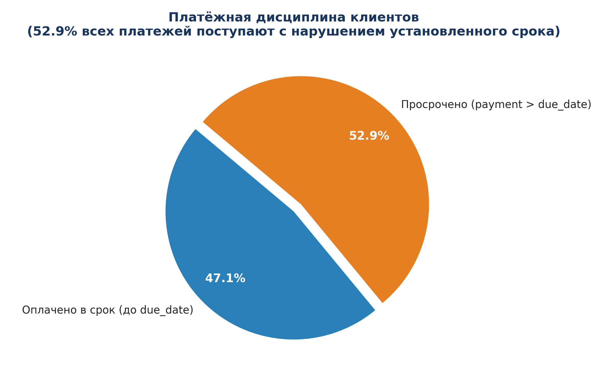

# AcademyIT_SQL

Репозиторий практических и лабораторных работ по курсу **«Углублённый SQL»** (Академия IT).  
Сквозной бизнес-кейс: производственно-торговая компания **«Питание +»**.  
СУБД: **PostgreSQL 16** (Yandex Managed Service for PostgreSQL).

---

## 👥 Команда А: «Финансы и продажи»
* **Исследуемый бизнес-процесс:** «От заказа до денег» (*Order-to-Cash*).
* **Схема базы данных:** `pitanie` (23 таблицы).
* **Цель аналитической группы:** выявление источников прямых и косвенных финансовых потерь, аудит соблюдения коммерческих регламентов, кредитной политики и ценообразования.

---

## 📁 Структура репозитория

```text
AcademyIT_SQL/
│
├── docs/                       # Отчеты и аналитические записки в формате Word (.docx)
│   ├── Отчет_Модуль_0_Финансы_и_Продажи.docx   # Архитектура БД, классификация, Order-to-Cash
│   └── Отчет_Модуль_1_Финансы_и_Продажи.docx   # Фильтрация, сортировка, первые улики
│
├── sql/                        # SQL-скрипты с запросами и комментариями
│   ├── lab00_team_a.sql                        # Скрипт Модуля 0: связи, структура, аудит
│   └── lab01_team_a.sql                        # Скрипт Модуля 1: фильтрация, улики, пагинация
│
├── images/                     # Графики, диаграммы и аналитические визуализации
│   ├── 01_discounts_breakdown.png              # Распределение скидок по строкам заказов
│   ├── 02_butter_margin_analysis.png           # Сравнение базовой цены и себестоимости масла
│   ├── 03_shipment_punctuality.png             # Своевременность отгрузок заказов клиентам
│   ├── 04_payment_punctuality.png              # Платежная дисциплина (дебиторская задолженность)
│   └── 05_order_lifecycle.png                  # Воронка статусов заказов в системе
│
├── scripts/                    # Python-скрипты автоматизации и визуализации
│   ├── build_report.py                         # Генератор Word-отчета по Модулю 0
│   ├── build_report_m1.py                      # Генератор Word-отчета по Модулю 1
│   └── generate_charts.py                      # Генератор аналитических графиков
│
└── README.md                   # Документация репозитория
```

---

## 🔍 Ключевые аналитические находки (Модули 0 и 1)

### 1. Несанкционированные скидки сверх регламента 10 %
Политикой компании запрещены скидки более 10 %. Однако в данных **4 365 позиций (24.8 % всех продаж)** отгружены со скидками до 25 %.  
* **Суммарный перерасход сверх норматива:** **17 979 376,44 ₽**!
* **Персональная улика:** Все 10 крупнейших убыточных скидок выданы **одним менеджером — Соколовым И. А. (`employee_id = 10`)** преимущественно одному клиенту (**ООО «Свежесть-Трейд»**, `customer_id = 7`).


---

### 2. Продажа сливочного масла ниже плановой себестоимости
* **Масло сливочное 82,5 % (180 г):** базовая цена в прайс-листе (**189 ₽**) изначально **ниже себестоимости (205 ₽)**.  
  👉 **100 % продаж (552 из 552 сделок) проведены с прямым гарантированным убытком.**
* **Масло сливочное 72,5 % (180 г):** базовая маржа всего 8 ₽ (5 %). Из-за скидок менеджеров **69.7 % продаж (365 из 524 сделок)** ушли в минус.


---

### 3. Нарушение платёжной дисциплины и кассовые разрывы
* **52.9 % всех платежей (2 391 транзакция)** поступают позже контрактного срока (`payment_date > due_date`).
* Компания фактически выступает бесплатным банком для ритейла, замораживая оборотный капитал на недели и месяцы.



---

### 4. Срыв сроков комплектации и возвраты скоропорта
* **23.2 % отгрузок (984 заказа)** сорвали требуемую дату доставки клиенту (`shipped_date > required_date`).
* Для ультрасвежих продуктов с коротким сроком годности (йогурты — 7 дней, кефир — 10 дней) задержка отгрузки на 5–6 дней приводит к 100% списанию партии магазином и возврату поставщику.


---

## 🛠️ Запуск и воспроизведение

### Требования:
* Python 3.10+
* Установленные библиотеки: `pip install python-docx matplotlib`
* PostgreSQL-клиент (`psql`) для выполнения запросов.

### Выполнение скриптов:
```bash
# Генерация отчетов Word
python scripts/build_report.py
python scripts/build_report_m1.py

# Генерация графиков
python scripts/generate_charts.py
```
